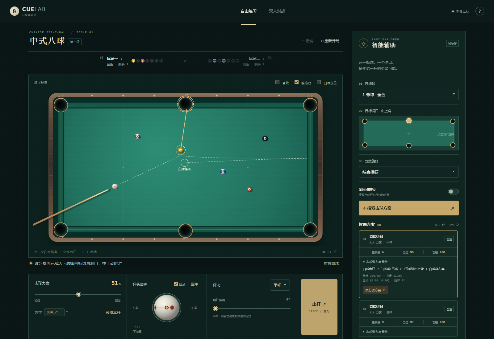
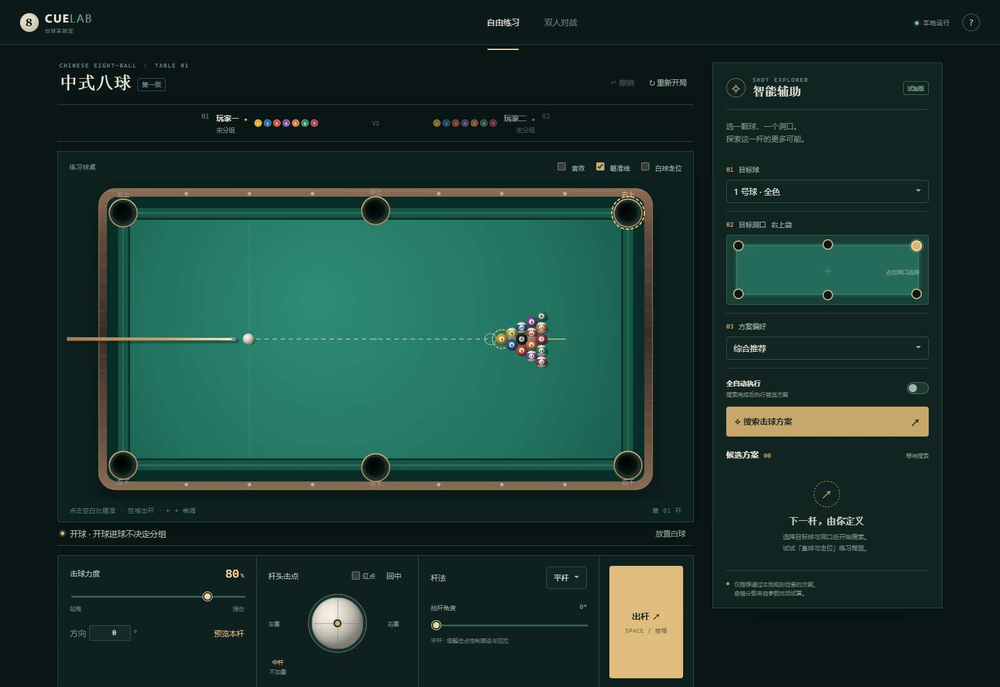
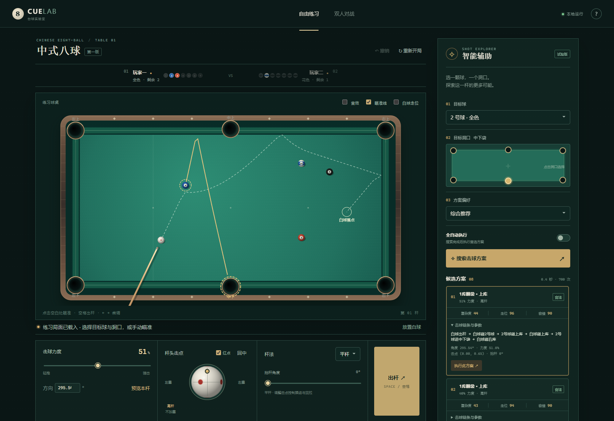

# CUE LAB · 台球实验室

**一款带智能击球辅助的浏览器 2D 桌球游戏。选目标球、选洞口，探索同一杆的不同解法。**

支持中式八球、自由练习和本地双人对战。你可以手动控制方向、力度、高低杆与左右塞，也可以让程序试算多个合法方案，比较击球复杂度、白球走位和参数容错，再选择执行。

使用 **TypeScript · Canvas 2D · Web Worker · Web Audio**，面向电脑端 Chrome / Edge。游玩、轨迹预览与辅助搜索均在浏览器本机完成，无需登录、服务端计算或外部 AI 接口。



*实际程序截图：选择目标球与洞口后，查看多个候选方案及当前方案的轨迹和参数。*

## 能玩什么

| 功能 | 当前实现 |
| --- | --- |
| 中式八球 | 开球、分组、轮流击球、犯规自由球、指定洞口打黑八；支持自由练习和本地双人对战 |
| 手动击球 | 点击或按住拖动瞄准，精细角度调整，力度滑块，击点控制高杆、低杆和左右塞 |
| 特殊杆法 | 手动跳球、扎杆，调整抬杆角度与偏心击点，并查看模拟轨迹 |
| 智能辅助 | 搜索直接进球、单库翻袋、单库解球及简单组合球，最多展示 8 个不同方案 |
| 方案比较 | 合法性筛选，按复杂度、下一杆优势、容错或综合评分排序；显示完整击球事件链条 |
| 轨迹预览 | 查看本杆受影响球的路线、目标球路径和白球最终落点；支持白球走位预览开关 |
| 击球反馈 | 完整长度球杆的后拉、出杆和收杆动画；随撞击强度变化的击球、碰球、碰库和落袋音效 |
| 球面与落袋 | 球号和条纹随三维姿态滚动；白球红点可切换；击点窗口从球杆视角同步显示旋转；落袋时旋转、缩小、变暗 |
| 练习工具 | 多种内置练习局面，自由摆球、移出和恢复球、放置白球，以及撤销 |

**全自动执行**：勾选后，搜索完成即执行排名第一的方案。每次搜索仍由你指定目标球和洞口。

## 画面展示

| 标准开球与手动控制 | 翻袋方案与走位预览 |
| --- | --- |
|  |  |

截图来自当前程序的真实界面与实际搜索结果。点击图片可查看大图。

## 本地运行

安装 [Node.js](https://nodejs.org/) 后，在项目目录执行。推荐 Node.js 22.12+，也支持 20.19+。

```bash
npm ci
npm run dev
```

打开终端显示的地址，默认是 [http://127.0.0.1:5173/](http://127.0.0.1:5173/)。Windows 用户也可双击 `启动游戏.cmd`，自动安装缺失依赖、启动服务并打开浏览器；关闭终端即可停止服务。

构建与预览生产版本：

```bash
npm run build
npm run preview
```

构建产物位于 `dist/`，可部署到支持静态文件的托管服务。页面须通过 HTTP / HTTPS 访问，直接双击 `index.html` 无法加载模块和 Worker。

## 第一次试用

1. 从球桌下方的练习局面菜单选择 **直球与走位**。
2. 点击彩球选择目标，点击球洞选择目标洞口。
3. 点击右侧 **搜索击球方案**，等待候选方案生成。
4. 选择方案，查看球桌上的轨迹、白球落点、评分与击球链条。
5. 点击 **执行此方案**，或修改力度和击点后手动出杆。
6. 切换到 **翻袋练习 / 单库解球 / 组合球练习**，探索不同路线。

## 操作速查

| 操作 | 作用 |
| --- | --- |
| 点击 / 按住拖动空白台面 | 调整击球方向 |
| 点击彩球 / 球洞 | 选择搜索目标球 / 洞口，同时指定本杆黑八洞口 |
| `←` / `→` | 每次微调方向 0.02°；按住 `Shift` 为 0.005° |
| 方向输入框 | 直接输入角度 |
| 力度滑块 | 调整 1–100% 力度 |
| 拖动杆头击点 | 调整高低杆、左右塞，可叠加 |
| 杆法与抬杆角度 | 选择平杆、跳球、扎杆 |
| 预览本杆 | 显示当前参数的模拟路线；白色虚线为白球，金色实线为目标球，淡色线为其他受影响球 |
| 白球走位 | 调整参数时显示模拟路线及白球落点 |
| 音效 / 红点 | 球桌上方切换音效；杆头击点窗口切换白球旋转标记 |
| `Space` | 出杆 |
| `Ctrl+Z` / `Cmd+Z` | 撤销 |
| `Esc` | 取消搜索或退出摆球 / 放置模式 |

输入框内不会触发出杆快捷键。犯规获得自由球后，点击台面合法位置放置白球；练习模式也可主动放置白球。

## 智能辅助如何工作

搜索先根据球位生成几何候选路线，再枚举方向偏移、力度和击点，通过与实际游玩相同的物理引擎模拟。只有进入指定洞口且通过当前规则检查的方案才会入选，再按路线、杆法与白球落点保留不同方案。

- **复杂度**：考虑碰球与碰库次数、加塞、高低杆和大力度等因素，分数越低越简单。
- **走位**：评估下一球的直球可打性、距离、切球角度、遮挡与白球贴库情况，分数越高越有利；导致换人时反向评估对手的机会。
- **容错**：对角度、力度和击点做 10 次小幅扰动，统计仍能合法完成目标的比例，分数越高越稳定。

走位分数目前使用几何评估，尚未实际搜索下一杆或推演整局；容错分数也不代表真实世界的进球概率。搜索在一个 Web Worker 中运行，可查看进度并立即取消。

## 规则与实现范围

本版采用固定的**中式八球休闲规则约定**，适合练习和本地游玩。

<details>
<summary>展开查看本版规则</summary>

1. 开球需进球或至少四颗目标球碰库，否则犯规。开球进球不分组；开球黑八入袋或离台重置黑八。合法开球进球继续。
2. 开放球局可先碰任一非黑八目标球；非开球时合法打进单一组别后分组，两组同时入袋仍为开放。
3. 分组后先碰己方球；清空己方球后才可首先击打黑八。合法进己方球继续，否则换人。
4. 白球落袋、先碰错球、空杆、球离台、碰球后既无进球也无碰库均为犯规，对方全台自由球。
5. 打黑八前己方球须在上一杆结束后已清空，并指定黑八洞口。提前进黑八、进错袋、打飞黑八或进黑八同时犯规判负。
6. 打飞或犯规打进的普通目标球不重置。尚未实现推杆、连击、故意犯规和三犯裁判机制。

</details>

物理引擎包含球间旋转传递、滑动与滚动摩擦、碰库旋转、球袋开口和袋角碰撞，以及离台重力与落地效果。采用近似模型，尚未对照真实球台做专业校准；落袋动画属于视觉反馈，不是精细球袋内部物理。

当前仍有以下边界：

- **跳球与扎杆支持手动操作及预览，尚未加入自动搜索。**复杂多库、多球组合也未系统枚举。
- 有限候选搜索未找到方案时，局面仍可能有其他解法。
- 使用 CPU 计算，尚未实现 WebGPU、WebAssembly、电脑对手或联网对战。
- 尚无跨刷新存档；刷新页面会重新开局。

## 开发与验证

```bash
npm test               # 物理、旋转、规则、搜索和反馈逻辑
npm run test:browser   # 真实界面的操作与击球流程
npm run test:render    # 球面滚动、遮挡、高光与旋转标记
npm run build          # TypeScript 检查与生产构建
npm run screenshots    # 更新 README 中的三张展示截图
```

目前有 **34 项自动测试**。浏览器回归验证搜索与实际执行的球位和旋转姿态一致，也覆盖出杆期间的操作锁定、落袋动画、静音、撤销、全自动、黑八胜负和双人自由球等流程。

浏览器脚本默认使用本机 Chrome，服务未启动时会自动启动。可通过环境变量 `CUE_LAB_BROWSER=msedge` 使用 Edge，或通过 `CUE_LAB_TEST_URL` 指向已运行的服务。测试截图输出到被 Git 忽略的 `test-results/`；展示截图输出到随源码提交的 `docs/screenshots/`。

<details>
<summary>项目结构</summary>

| 路径 | 职责 |
| --- | --- |
| `src/main.ts` | 交互、游戏流程、搜索控制、撤销与状态更新 |
| `src/physics.ts` | SI 单位、1/240 秒固定物理步长、摩擦、旋转、碰撞与轨迹 |
| `src/rules.ts` | 合法首碰、分组、犯规、换人和黑八结算 |
| `src/search.ts` | 候选路线、批量试算、规则过滤、方案差异化与评分 |
| `src/search.worker.ts` | 后台搜索入口 |
| `src/renderer.ts` | Canvas 球桌、球杆、瞄准与路线绘制 |
| `src/ball-surface.ts` / `src/rotation.ts` | 球面投影、四元数姿态与实际滚动显示 |
| `src/shot-feedback.ts` / `src/audio.ts` | 出杆、落袋动画与本地合成音效 |
| `src/types.ts` / `src/scenes.ts` | 状态类型与可重复的练习局面 |
| `tests/` | 自动测试和浏览器回归 |
| `scripts/screenshots.mjs` | 通过真实界面操作生成展示截图 |
| `docs/screenshots/` | README 展示图片 |

</details>
